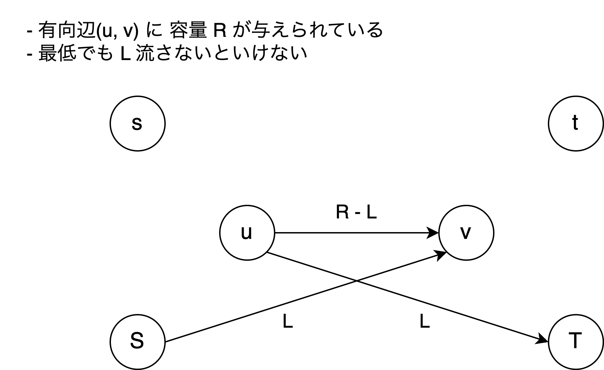
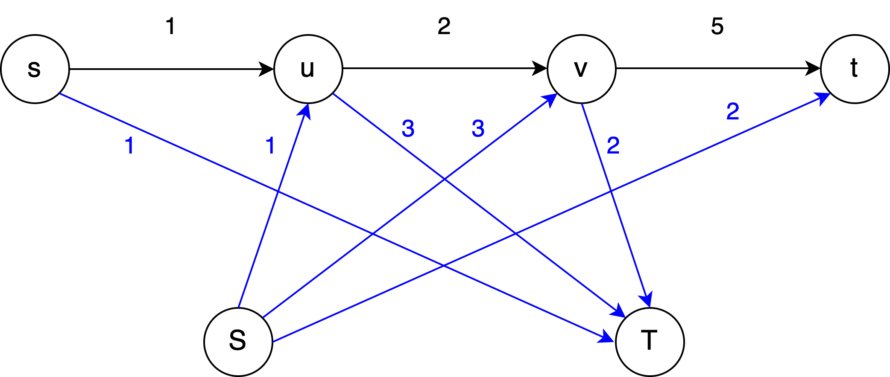

## 目次

## 問題

> 有向グラフ $G = (V, E)$ において、各辺 $e \in E$ に容量 $c(e)$ が割り当てられている。
> 各辺 $e \in E$ には最低でも $b(e)$（下限制約）流さなければならない時、始点 $s$ から終点 $t$ に流せる最大フローを求めよ。
> また、フローを流すことができないならそのことを報告せよ。

## アルゴリズム

$s, t$ とは別に、新しい始点と終点 $S, T$ を追加する。
辺 $(u, v)$ に容量 $R$、下限制約 $L$ が与えられている時、以下のように辺を張る。

上の画像のように辺を張って、

1. $S \rightarrow T$
2. $s \rightarrow T$
3. $S \rightarrow t$
4. $s \rightarrow t$

の順番に流す。

$S$ または $T$ のいずれかに接続する辺が全て「流量 = 容量」になっていれば、元のグラフで下限制約を満たすフローが存在し、答えは 2 と 4 の最大流の和になる。
$S$ または $T$ のいずれかに接続する辺のうち「流量が容量より小さい」辺が存在するならば、元のグラフにおいて下限制約を満たすフローが存在しない。

## お気持ち

このアルゴリズムの正当性をお気持ちで理解するために、次の例を挙げて説明する。

![例となるグラフ。s → u が [1, 2]、u → v が [3, 5]、v → t が [2, 7]。表記は [下限制約, 容量]](../../assets/images/max-flow-with-lower-bounds/example-original.png)

このグラフは先程のアルゴリズムで説明したように次のようなグラフに変形する：

まず、この辺の張り方は、例えば上図の辺 $(u, v)$ について見てみると、

- $u$ から流れる流量のうち、下限 3 を $T$ に吸収させ、残りの $5 - 3 = 2$ を $v$ に流す。
- $T$ に吸収させた下限 3 の分の流量を $S$ から補填する。

という気持ちに基づいている。

また、この気持ちを元にすると、下限制約を満たすようなフローを流すには、上の画像で言うところの青い辺を優先的に使ってフローを流す必要がある。

まず、$T$ に吸収させた後 $S$ に補填してもらう必要があるため、「$S$ に補填してもらった分がまた $T$ に吸収されてしまう」ようなことがあってはならない。$S$ に補填してもらった分は必ず元の行き先の頂点に流れてもらう必要がある。
これを防ぐために、まず $S \rightarrow T$ にフローを流す。

次に青い辺を優先的に使うため、$s \rightarrow T$、$S \rightarrow t$ に流す。この流す順番はどちらでも良い（多分）。
最後に $s \rightarrow t$ に流して終了する。

こうして流したフローの和（$S \rightarrow T, s \rightarrow T, S \rightarrow t, s \rightarrow t$ の最大流の和）を $F'$、元のグラフの最大流を $F$ とすると、$F' = F + \sum_{e \in E} b(e)$ になっている。
これは各辺について、下限の分の流量を $s, S$ からそれぞれ 2 回流しているため、$F'$ は下限の和の分だけ余分に流してしまっているから。

また、上のお気持ちを元にすると、青い辺の流量が容量に等しくなかったら下限制約を満たさないことも分かる（と思う）。

## 備考

蟻本には次のように書かれていた：

- 下限制約を満たすことが保証されている場合、変形後のグラフに $S \rightarrow s, t \rightarrow T$ に容量 $\infty$ の辺を張って $S \rightarrow T$ に流すと、$F' = F + \sum_{e \in E} b(e)$ になる。
  - この場合、青い辺が「流量 = 容量」にならない場合もあるが、変形後のグラフの最大フローは今までの議論で $F + \sum_{e \in E} b(e)$ であることが分かっているので、別に青い辺が「流量 = 容量」にならなくても最大フローは必ず $F + \sum_{e \in E} b(e)$ になる。
- 下限制約を必ず満たすことが保証されていない場合、変形後のグラフに $t \rightarrow s$ に容量 $\infty$ の辺を張って $S \rightarrow T$ に流し、青い辺が全て「流量 = 容量」になっていれば下限制約を満たすフローが存在すると言える。
  - $S, s$ から流れた水は必ず $t \rightarrow s$ を経由して $s$ に戻ってくるので、青い辺を限界まで使うことになる。

## 参考資料

- https://snuke.hatenablog.com/entry/2016/07/10/043918
- https://atcoder.jp/contests/abc285/tasks/abc285_g/editorial
- 蟻本第 2 版 p.193
